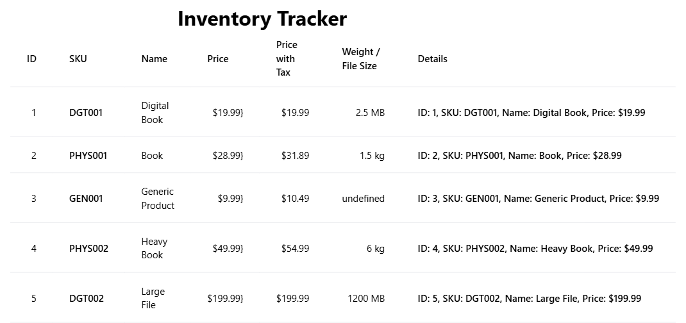

# Inventory Tracker

## By [Mamadou Moussa Balde](https://www.linkedin.com/in/2mb/)

A Vite page that builds five products in TypeScript and draws them in one table. The heading is **Inventory Tracker**. The browser tab title is **My inventory Tracker App**. Nothing on the page is clickable. The rows stay in the order the products were created.

The page does not set a background color. On a narrow window the Details column runs past the right edge and the page scrolls sideways. This screenshot shows the whole table.



## What the table shows

| ID | SKU | Name | Price | Price with tax | Weight / file size |
| --- | --- | --- | --- | --- | --- |
| 1 | DGT001 | Digital Book | $19.99 | $19.99 | 2.5 MB |
| 2 | PHYS001 | Book | $28.99 | $31.89 | 1.5 kg |
| 3 | GEN001 | Generic Product | $9.99 | $10.49 | undefined |
| 4 | PHYS002 | Heavy Book | $49.99 | $54.99 | 6 kg |
| 5 | DGT002 | Large File | $199.99 | $199.99 | 1200 MB |

Every cell in the Price column ends with `}`. The template writes an extra brace after the formatted price. The Price with Tax column does not.

**Book** starts at $29.99. Before the table is drawn, `applyBulkDiscount(1, 1)` runs on that product. Its weight is 1.5 kg, which is above 1, so the price drops by 1 to $28.99. Heavy Book stays at $49.99. The discount method is not called for it. A weight of `6.0` is shown as `6 kg`.

**Price with Tax** calls `getPriceWithTax`. A physical product uses 10 percent, so Book is $31.89 and Heavy Book is $54.99. A plain `Product` uses 5 percent, so Generic Product is $10.49. A digital product returns its price with no tax, so both digital rows match the Price column. `applyDiscount` exists on digital products and is never called, so those prices stay at the values from the constructor.

**Weight / File Size** reads `weight` for a physical product and `fileSize` for anything else. Generic Product is neither a physical nor a digital product, so that cell is the word `undefined`.

The Details column repeats id, SKU, name, and price from `displayDetails()`.

## Console

The same five products are printed in the browser console, once sorted by name and once by price from high to low. Those sorts do not change the table. Book is already $28.99 when the lines are printed.

Sorted by name:

```text
ID: 2, SKU: PHYS001, Name: Book, Price: $28.99 Price with tax: $31.89
ID: 1, SKU: DGT001, Name: Digital Book, Price: $19.99 Price with tax: $19.99
ID: 3, SKU: GEN001, Name: Generic Product, Price: $9.99 Price with tax: $10.49
ID: 4, SKU: PHYS002, Name: Heavy Book, Price: $49.99 Price with tax: $54.99
ID: 5, SKU: DGT002, Name: Large File, Price: $199.99 Price with tax: $199.99
```

Sorted by price, high to low: Large File, Heavy Book, Book, Digital Book, Generic Product.

## Getting started

```bash
npm install
npm run dev
```

Vite serves the page at `http://localhost:5173/`.

| Command | What it does |
| --- | --- |
| `npm run dev` | Start the Vite dev server |
| `npm run build` | Type-check with `tsc`, then build for production |
| `npm run preview` | Serve the production build |

## Products

`Product` stores a private id, SKU, and name, and a protected price. Getters expose them. `getPriceWithTax` adds 5 percent. `displayDetails` returns one sentence.

`PhysicalProduct` adds weight in kilograms and overrides tax to 10 percent. `applyBulkDiscount(weightThreshold, discountAmount)` subtracts `discountAmount` from the price when the weight is greater than the threshold.

`DigitalProduct` adds a file size in megabytes, implements `DiscountableProduct.applyDiscount`, and overrides `getPriceWithTax` to return the price unchanged.

`calculateTax` calls `getPriceWithTax`. `sortProductsByName` and `sortProductsByPrice` copy the array and sort that copy. `sortProductsByPrice` is called with `false`, so the console list is highest price first.

# Critical Thinking

### 1. How does TypeScript enforce type safety in this object-oriented program?
TypeScript enforces type safety by allowing developers to define static types for class properties, method parameters, and return values (e.g., specifying a `price` must be a `number`). It validates these types at compile-time, catching errors before the code runs. Additionally, it ensures that instances of classes strictly adhere to their defined interfaces or parent class structures.

### 2. How did inheritance reduce code duplication for PhysicalProduct and DigitalProduct?
Inheritance allows both `PhysicalProduct` and `DigitalProduct` to inherit shared properties (like `id`, `name`, and `price`) and methods from a common base `Product` class. This means the core properties and logic only need to be written once in the `Product` class, preventing the need to duplicate that same code across all specific product subclasses.

### 3. What are the benefits of using encapsulation and access modifiers (public, private, protected) in this context?
Encapsulation safeguards an object's internal state. Using access modifiers:
- `private` prevents external code from directly modifying critical properties (like an internal ID), protecting the object from invalid states.
- `protected` allows subclasses to access base class properties while keeping them hidden from the outside.
- `public` defines a controlled, predictable API (via methods or getters/setters) for external code to interact with the object safely, hiding the underlying implementation details.

### 4. If you had to add a new type of product (e.g., a SubscriptionProduct), how would polymorphism make this extension straightforward?
Polymorphism allows different subclasses to be treated as instances of their common base class. If you add a `SubscriptionProduct` that inherits from `Product`, you can add it to an existing array of `Product`s. When you call a shared method (like `getDetails()`) on each item in the array, the specific implementation for `SubscriptionProduct` will automatically execute. You don't need to write custom logic or complex `if-else` checks to handle the new product type in the rest of your program.
